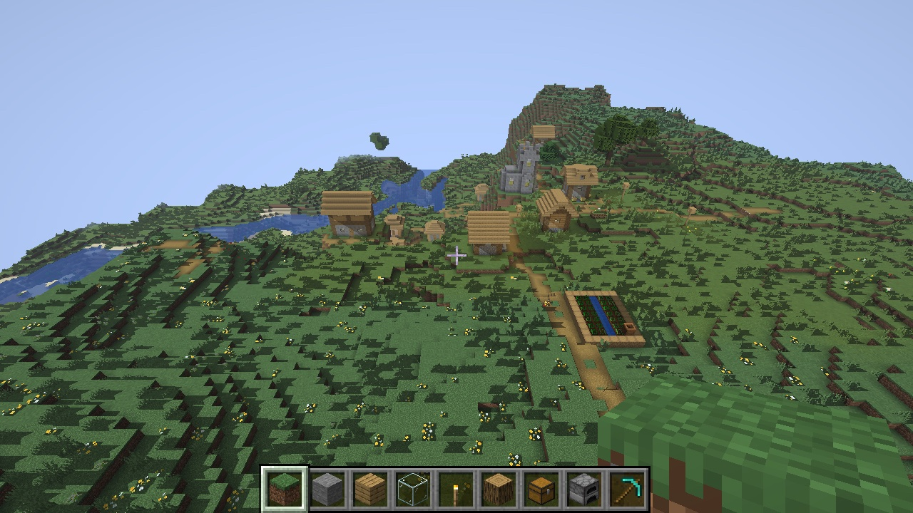
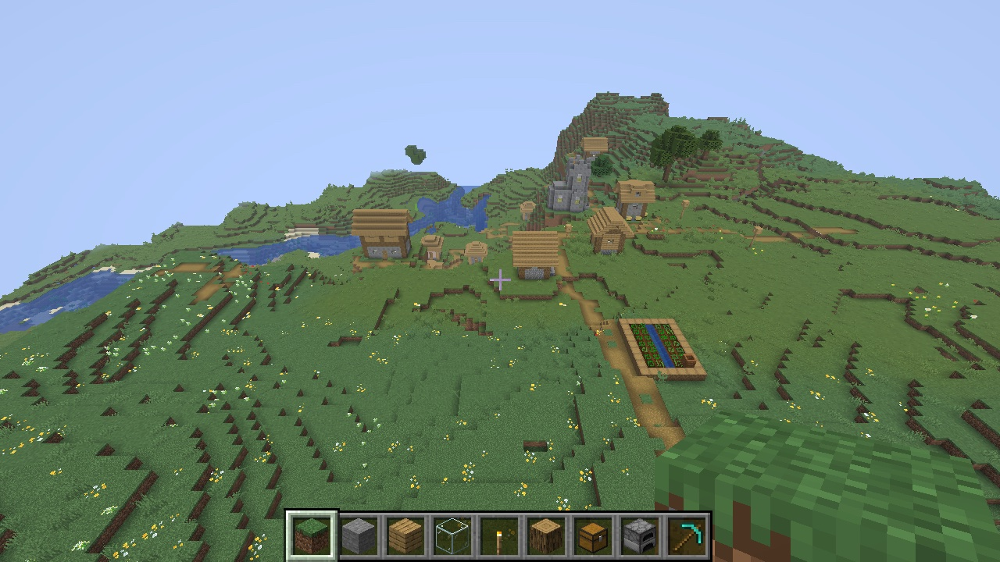

# Ray tracing: research spike (raytracing-1)

Status: **experimental prototype, off by default.** Nothing changes for players: the code runs only when the
game is started with `HORIZON_RT_SHADOWS=1` on a GPU that has hardware ray queries. Without that variable the
device is created exactly as before, and the vanilla look stays the default. This page answers FEATURES.md item 15's
spike questions with measurements, so Ludovic can decide whether to go further.

## What the prototype does

Sun shadows on solid terrain, traced with ray queries:

- **One BLAS per chunk section** (bottom-level acceleration structure): the section's solid quads, built straight from
  the section arena's vertex buffer (positions are the first 12 bytes of `TerrainVertex`) and the shared quad index
  buffer, so nothing is copied. Translucent quads (water, glass) are left out. BLAS are compacted once the GPU reports
  their size (`HORIZON_RT_COMPACT=0` keeps them as built). At most 512 builds per frame.
- **One TLAS rebuilt every frame**: every section with a BLAS, placed camera-relative like the terrain's own origins.
  `HORIZON_RT_SHADOW_CHUNKS=N` keeps only sections within N chunks (horizontally) of the camera.
- **One ray per solid-terrain pixel** towards the sun (`terrain_rt.wgsl`, a variant of the solid terrain pipeline). A
  shadowed pixel reads the lightmap with its sky light scaled by 0.55, so block light (torches) and caves keep the
  vanilla look, and faces turned away from the sun are in their own shadow. No shadows at night.
- A section that is remeshed (any block change) drops its BLAS and builds a new one on the next frame.

Code: `crates/horizon-client/src/gfx/raytrace.rs`, `crates/horizon-client/src/terrain_rt.wgsl`, and
`crates/horizon-gpu-experimental` (wgpu's experimental features need an `unsafe` opt-in, which horizon-client's
`forbid(unsafe_code)` doesn't allow). Control socket: `rt-shadows [on|off|rebuild|bench-builds]`. Measurements:
`python3 tools/rt_shadow_bench.py --build target/fast --distances 12,32 --offscreen --out rt.json`.

More in `shots/raytracing-1/` (forest, and the RTX 4080's frames).

## 1. wgpu and the backends

Horizon is on **wgpu 30.0.1** (with a patched wgpu-hal, `third_party/wgpu-hal`). Its ray tracing is
`Features::EXPERIMENTAL_RAY_QUERY` (BLAS/TLAS, ray queries in any shader stage); devices must also pass
`ExperimentalFeatures::enabled()`, an `unsafe` acknowledgement that the API is still changing.

| Backend | In wgpu 30 | Measured here | Needs |
| --- | --- | --- | --- |
| Vulkan | `VK_KHR_acceleration_structure` + `VK_KHR_ray_query` | **works** on the RTX 4080 (driver 595.71.05) | RTX 20 and newer, Radeon RX 6000 and newer, Intel Arc |
| Metal | `supportsRaytracing` and `supportsRaytracingFromRender`, macOS 15+ | **works** on the Apple M4 Pro | Apple silicon. M1/M2 also report ray tracing, but without RT hardware (it runs on shader cores): a real setting should offer it from M3 (Apple9 family) up |
| DX12 | DXR tier 1.1 and shader model 6.5 | not tried (no Windows machine) | DXC: Horizon compiles DX12 shaders with FXC (shader model 5.1) unless `dxcompiler.dll` is on the PATH, so DX12 normally reports no ray queries today. Windows defaults to Vulkan anyway, so RTX/Radeon players on Windows get it through Vulkan; shipping DXC (or wgpu's `static-dxc`) is only needed for DX12-only machines |

Validation: naga translates the shader for all three (`gfx::tests::ray_traced_shadow_shader` checks HLSL 6.5); the
games on Vulkan and Metal ran every scene below without a wgpu error (wgpu-core validates every BLAS/TLAS build and
bind group, and wgpu's default error handler panics on any error).

## 2. Cost, measured

Setup: `tools/rt_shadow_bench.py`, perf_bench's world (seed 1234), creative, clear noon, 1280x720 offscreen, unlimited
frame rate, holding still 10 s at two scenes (village: plains; mountain: snowy peaks, the heaviest terrain).
"Vanilla" is the game as players get it (no ray queries requested). "RT off" is the same ray-traced start with the
shadows not drawn but the TLAS still rebuilt every frame.

**Caveat:** both machines were shared with other agents' builds and harnesses while measuring (the Mac mini at
80-97 % CPU, the desktop at 50-96 %), so CPU-side frame times are noisy: compare medians, not single numbers. The 4080's
GPU times come from timestamp queries and are reliable; Metal on Apple GPUs can only time pass boundaries, which gives
nothing usable for these passes, so Metal is judged on frame times.

### RTX 4080 (Vulkan), GPU time per frame (median, timestamps)

| RD | Scene | Vanilla | RT on | RT off (TLAS only) | Shadow rays + TLAS |
| --- | --- | --- | --- | --- | --- |
| 12 | village | 0.28 ms | 0.14 ms | 0.38 ms | within noise |
| 12 | mountain | 0.08 ms | 1.27 ms | 0.44 ms | +1.2 ms |
| 32 | village | 2.40 ms | 3.06 ms | 1.88 ms | +0.7 ms |
| 32 | mountain | 1.36 ms | 2.41 ms | 2.14 ms | +1.1 ms |

The GPU is not the limit on a 4080: tracing a shadow ray per pixel and rebuilding a 31 000-instance TLAS cost about
1 ms. **The CPU is**: frame times (median) went from 3.8 / 3.7 ms (vanilla, RD 32 village / mountain) to 15.6 / 8.0 ms
with the shadows on. The TLAS fill alone takes 2-7 ms of CPU per frame at RD 32 (`cpu_ms`: wgpu validates and
tracks every instance on every build), against 0.6-1.1 ms at RD 12. With the TLAS capped to 8 chunks (2 500-3 300 instances
instead of 26 000-31 000), RD 32 village ran at 2.8 ms a frame (0.61 ms GPU) with the shadows on; the mountain run
(12.3 ms, 2.2 ms GPU) was taken while the desktop's CPU was 97 % busy with other jobs and says little.

### Apple M4 Pro (Metal), frame time (median)

| RD | Scene | Vanilla | RT on | RT off (TLAS only) | RT on, TLAS capped to 8 chunks |
| --- | --- | --- | --- | --- | --- |
| 12 | village | 0.39 ms (flat draws), 1.96 ms (without) | 4.37 ms | 1.39 ms | |
| 12 | mountain | 2.84 ms | 5.54 ms | 1.89 ms | |
| 32 | village | 3.93 ms | 15.7 ms | 12.1 ms | 10.8 ms |
| 32 | mountain | 3.96 ms | 32.0 ms | 16.5 ms | 15.3 ms |

On the M4 Pro the rays themselves cost about 3 ms per frame at 1280x720, and the per-frame TLAS of every section is
the larger cost at RD 32 (8-12 ms). Capping the TLAS to 8 chunks brings "RT off" back to 3.3 / 5.4 ms, near vanilla:
shadows from terrain more than 128 blocks away are under fog anyway. (With the ray-traced pipeline the M4 Pro draws
sections per section rather than with the flat draws it normally uses; that accounts for part of the gap at RD 12.)

### BLAS builds (timed with waited submissions, `rt-shadows bench-builds`)

| GPU | Per section, GPU | Per section, CPU | Per 1000 triangles, GPU | Whole RD 32 world (26 000-31 000 sections) |
| --- | --- | --- | --- | --- |
| RTX 4080 | 35-41 µs | 21-26 µs | 30-39 µs | 1.1 s GPU + 0.65 s CPU |
| M4 Pro | 16-22 µs | 11-27 µs | 16-19 µs | 0.5-0.7 s GPU + 0.5 s CPU |

A section averages about 1 000-1 200 solid triangles. Builds spread over frames (512 at most per frame) while a world
loads; rebuilding a whole RD 32 world that way kept frames at 7-14 ms median on the 4080.

### Memory

| | RD 12 village | RD 12 mountain | RD 32 village | RD 32 mountain |
| --- | --- | --- | --- | --- |
| BLAS triangles | 2.9 M | 4.9 M | 28.4 M | 38.2 M |
| 4080, wgpu allocations: vanilla → RT (compacted) | 342 → 407 MB | 417 → 525 MB | 1 703 → 2 317 MB | 2 115 → 2 945 MB |
| 4080, nvidia-smi: vanilla → RT | 780 → 902 MB | 1 036 → 928 MB | 2 060 → 3 240 MB | 2 572 → 3 524 MB |
| M4 Pro, process footprint: vanilla → RT built → RT compacted | 1 454 → 2 442 → 2 298 MB | 1 605 → 2 832 → 2 608 MB | 3 623 → 6 946 → 5 613 MB | 3 916 → 8 653 → 6 765 MB |

About **22 bytes per triangle** on the 4080 once compacted (0.6-0.8 GB extra at RD 32), more on Metal (2-3 GB extra
at RD 32 even compacted). That is fine on 12-16 GB GPUs and too much for 4-8 GB ones at high render distances.

## 3. Keeping BLAS in sync with block updates

A block change remeshes 1-3 sections (more at section borders); each gets a new BLAS (a refit doesn't apply: the quad
count changes). Measured by filling and emptying a 32x32x32 box four times a second (about 35-50 sections per fill):

- 4080: 675-1 023 BLAS rebuilt in 8 s; frames with builds spent 1.7-3.6 ms GPU (TLAS included), at most 6.4 ms.
- M4 Pro: 778-1 212 rebuilt; no measurable change in median frame time (the p99 rose, as it does in vanilla while
  the same box remeshes).

Per changed section that is about 40 µs GPU + 25 µs CPU on the 4080, 20 µs + 20 µs on the M4 Pro. Ordinary play
(a few block changes a second) costs well under 0.1 ms a frame; explosions and big `/fill`s cost a few ms for a frame
or two, bounded by the 512-builds-per-frame cap. Sync is not the problem; the per-frame TLAS is.

## 4. Fallback

- Nothing is requested unless `HORIZON_RT_SHADOWS=1`: same device, same pipelines, same look as before.
- Asked for on a GPU without ray queries (or DX12 with FXC): a warning in the log, and the vanilla look.
- The control socket's `rt-shadows off` switches back to the vanilla solid pipeline at once (the BLAS stay).

## Limits of the prototype

- Cutout quads are opaque in the BLAS: grass, flowers and leaves cast square shadows (the speckles in the screenshot).
  Fixing it means alpha-testing candidates in the ray query loop (fetch the hit quad's UV from the arena and sample
  the atlas), or keeping plants out of the BLAS.
- Only solid terrain receives shadows; water, entities, block entities and particles neither cast nor receive.
- The Metal flat-draw path and shader packs don't use it (the ray-traced pipeline is the per-section one).
- Sections farther than the TLAS cap cast nothing; distant LOD tiles receive but never cast.
- One hard shadow ray, no soft shadows, no denoising, no moon shadows.

## Recommendation

**Go, as an opt-in "Ray-traced shadows (experimental)" video setting, but only after two fixes; no-go for
reflections and GI until those land.**

What works: ray queries run on Vulkan (RTX 4080) and Metal (M4 Pro) through wgpu 30 with no driver or validation
errors; per-section BLAS from the existing arena cost no copy; block updates are cheap to keep in sync; the shadows
read well with the vanilla lighting (block light untouched). The 4080's GPU barely notices (about 1 ms).

What blocks shipping:

1. **The per-frame TLAS over every section is too expensive on the CPU** at high render distances (2-7 ms of wgpu
   bookkeeping per frame at RD 32, 8-12 ms frame cost on the M4 Pro). Next: cap the TLAS to a shadow distance (the
   prototype's `HORIZON_RT_SHADOW_CHUNKS=8` already brings it near vanilla), and stop rebuilding it every frame:
   place instances in world space around an anchor that moves rarely and rebuild only when sections change or the
   anchor moves; or build the TLAS instance buffer ourselves (`build_acceleration_structures_unsafe_tlas`).
2. **Cutout geometry** (plants, leaves) must be alpha-tested, or the shadows look wrong in every grassy scene.

Then, in this order: gate Metal to M3 and newer; memory budget (cap BLAS to the shadow distance, drop far ones);
a video setting and the launcher toggle; water reflections (one more ray from the translucent pass, same TLAS);
global illumination last (many rays per pixel and a denoiser: a much bigger project). DX12 needs DXC shipped first.
wgpu's ray tracing is experimental and its API still changes between releases, so each wgpu upgrade will need a pass
over `raytrace.rs`.
